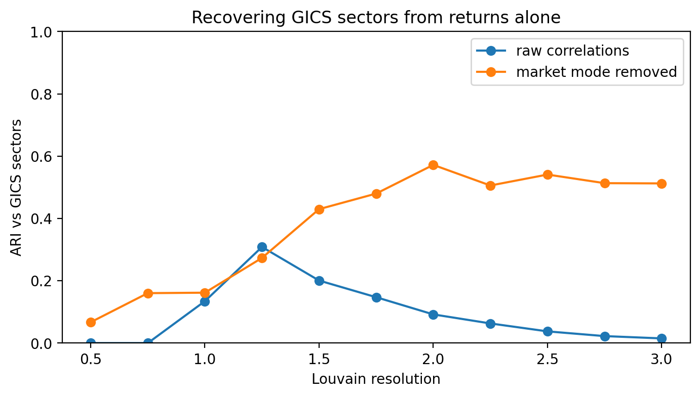
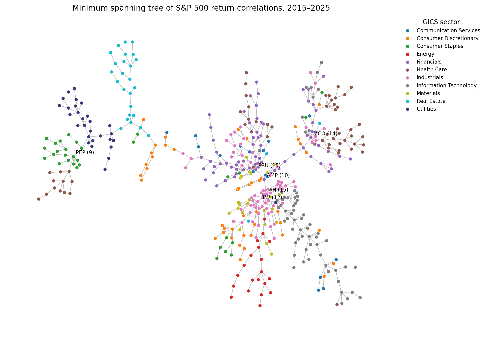

# Stock Correlation Networks: Market Structure from Returns Alone

How much of the stock market's structure can be recovered from price movements alone?

This project builds correlation networks from 11 years of daily returns for 455 S&P 500 stocks and asks:

1. **Signal vs noise.** How much of the correlation structure is real, and how much would appear by chance?
2. **Sectors.** Do communities found in the network match the official GICS sectors, and where they don't, why not?
3. **Backbone.** Which stocks form the core of the market, and which sit on the periphery?

It extends my honours thesis, *Graphs Among the Stars*, which used the same toolkit (Louvain community detection validated against known labels, null models, k-core decomposition) to recover constellations from star positions. Here the stars are stocks and the constellations are sectors.

**Status:** stages 1–6 complete. In progress: core–periphery and robustness (k-core, targeted node removal), and how the network changes in a crisis (COVID-19, 2020).

## Key results

| | |
|---|---|
| Data | 455 S&P 500 stocks, 2,764 trading days (2015–2025) |
| Market mode | Largest eigenvalue 165; explains **36%** of all variance |
| Signal modes | **35** eigenvalues above the Marchenko–Pastur noise bound |
| Sector recovery (Louvain vs GICS, ARI) | **0.32 ± 0.01** on raw correlations → **0.52 ± 0.04** after removing the market mode (10 seeds); hierarchical baseline 0.40 |
| Minimum spanning tree | **81%** of links join same-sector stocks vs **11%** under shuffled labels (z = 45) |

### 1. The market moves as one, and the next modes are style factors
The largest eigenvector puts a positive weight on every stock and correlates 0.999 with an equal-weighted index: it *is* the market. The next two are well-known investment styles, found with no financial input:
- **Eigenvector 2:** Utilities vs Technology (defensive vs growth)
- **Eigenvector 3:** Technology and Health Care vs Energy and Financials (growth vs value)

Being in the same sector adds only about 0.12 to a stock pair's average correlation of 0.33, so the market mode buries sector structure. Removing it with random matrix theory drops the between-sector baseline to about zero and makes sectors far easier to detect.

### 2. Communities recover sectors, and the "mistakes" are informative



After removing the market mode, Louvain finds exactly 11 communities (the number of GICS sectors, without being told). Health Care is the cleanest (56 of 61 stocks in one community). Most disagreements with GICS are economically meaningful:
- **Defence** (Lockheed Martin, General Dynamics, L3Harris) splits from the rest of Industrials: it follows government budgets, not the economic cycle.
- **Utilities and Real Estate** merge: both are interest-rate sensitive.
- **Energy** joins agriculture and chemicals (ADM, Bunge, CF Industries) in a commodities group.
- **Financials split by business model:** banks, asset managers and life insurers (whose profits move with rates and markets) vs insurers, brokers, exchanges and ratings agencies (steady fees and premiums), which group with other recurring-revenue firms such as Waste Management and Cintas.
- **Communication Services** is scattered across four communities: Google, Meta, Netflix and telecoms are very different businesses.

So an ARI of 0.52 understates how much real structure the method finds.

### 3. The minimum spanning tree shows a core and a periphery



The tree keeps the 454 strongest links connecting all stocks, using the Mantegna distance d = √(2(1 − ρ)).
- The strongest links are all intuitive pairs: Visa–Mastercard, Applied Materials–Lam Research, D.R. Horton–Lennar, chains of regional banks and of Midwest utilities.
- **Financials and Industrials form the core**, where the hubs are (Parker Hannifin, Prudential, Moody's, Illinois Tool Works); Real Estate, Utilities, Consumer Staples, Energy and Technology branch off as separate arms.
- **Moody's links a cross-sector "data and ratings" cluster:** S&P Global, MSCI, FactSet, Fair Isaac, Verisign, Equifax and Visa, spanning four GICS sectors. The market groups these firms by how they make money, not by what they sell.

## Methods

| Step | Method |
|---|---|
| Data | S&P 500 constituents and GICS sectors (Wikipedia); adjusted daily closes (Yahoo Finance via `yfinance`) |
| Cleaning | Complete price history required (gaps ≤ 5 days forward-filled); duplicate share classes removed (GOOG, NWS); log returns |
| Noise filtering | Eigenvalues compared with the Marchenko–Pastur bound, using the noise variance left after the market mode (Laloux et al. 1999) |
| Communities | Louvain on positive correlations, swept over resolution; scored against GICS with Adjusted Rand Index, homogeneity and completeness; average-linkage hierarchical clustering as a baseline; 10 random seeds |
| Spanning tree | Mantegna distance; minimum spanning tree; share of same-sector links vs 1,000 label shuffles |

## Notebooks

| Notebook | What it does |
|---|---|
| `01_explore_data.ipynb` | Download, inspect, clean; correlation heatmap; sanity-check the largest one-day falls |
| `02_random_matrix_theory.ipynb` | Eigenvalue spectrum, market mode, style factors, noise filtering |
| `03_minimum_spanning_tree.ipynb` | Spanning tree, hubs, sector null model |
| `04_communities_vs_sectors.ipynb` | Louvain vs GICS, community composition, seed stability |

Reusable code lives in `scn/` (`data.py`, `network.py`, `plots.py`). Working notes, including every design decision, are in `notes.md`.

## Run it

```bash
git clone https://github.com/rabbittibbar10/stock-correlation-network.git
cd stock-correlation-network
pip install -r requirements.txt
```

Then open the notebooks in order from the repository's top folder. The first run downloads the data (a few minutes) and caches it in `data/`, which is not committed.

## Limitations

- **Survivorship bias.** The sample uses today's index members with a complete 2015–2025 history. Recent IPOs and spin-offs (46 stocks) are excluded, and companies that left the index are missing entirely.
- **Current sector labels.** GICS assignments change over time; the ground truth here is today's classification.
- **Pearson correlation** measures linear, average co-movement and understates dependence in the tails, which matters most in a crash.
- **Marchenko–Pastur assumes independent, identically distributed returns.** Real returns have fat tails and changing volatility, so the noise bound is a guide rather than an exact cutoff.
- **Louvain's resolution was tuned against the labels**, so the ARI is a best case.

## References

- Mantegna, R. N. (1999). Hierarchical structure in financial markets. *European Physical Journal B*, 11, 193–197.
- Laloux, L., Cizeau, P., Bouchaud, J.-P. & Potters, M. (1999). Noise dressing of financial correlation matrices. *Physical Review Letters*, 83, 1467.
- Onnela, J.-P., Chakraborti, A., Kaski, K., Kertész, J. & Kanto, A. (2003). Dynamics of market correlations: taxonomy and portfolio analysis. *Physical Review E*, 68, 056110.
- Blondel, V. D., Guillaume, J.-L., Lambiotte, R. & Lefebvre, E. (2008). Fast unfolding of communities in large networks. *Journal of Statistical Mechanics*, P10008.

---

Built with AI-assisted development (Claude Code). Analysis, interpretation and design decisions are my own. MIT licence.